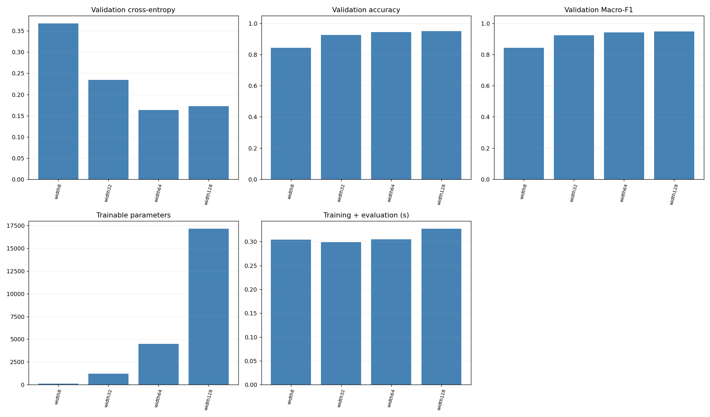
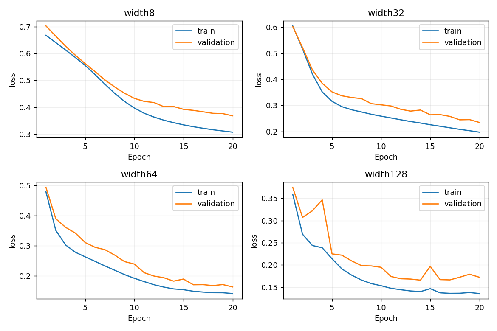
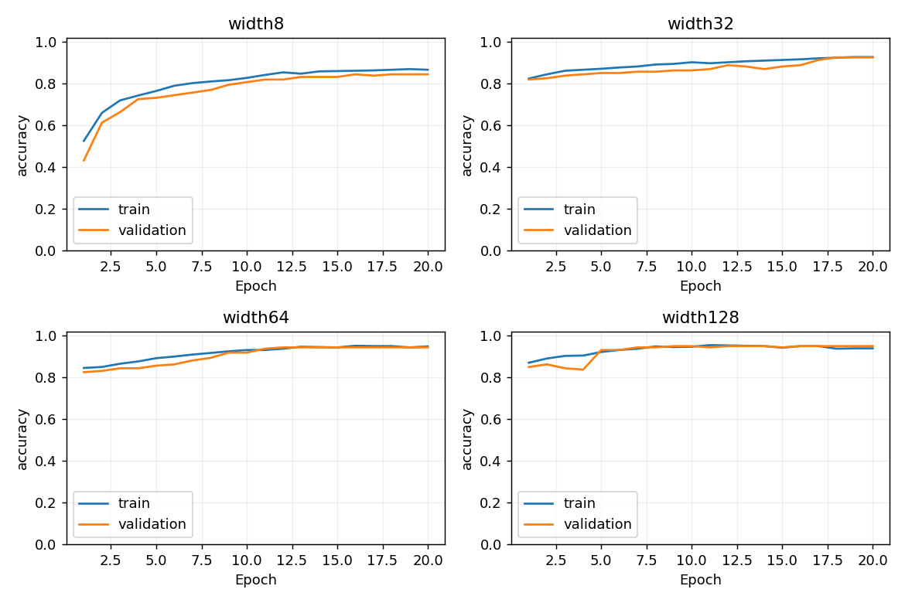
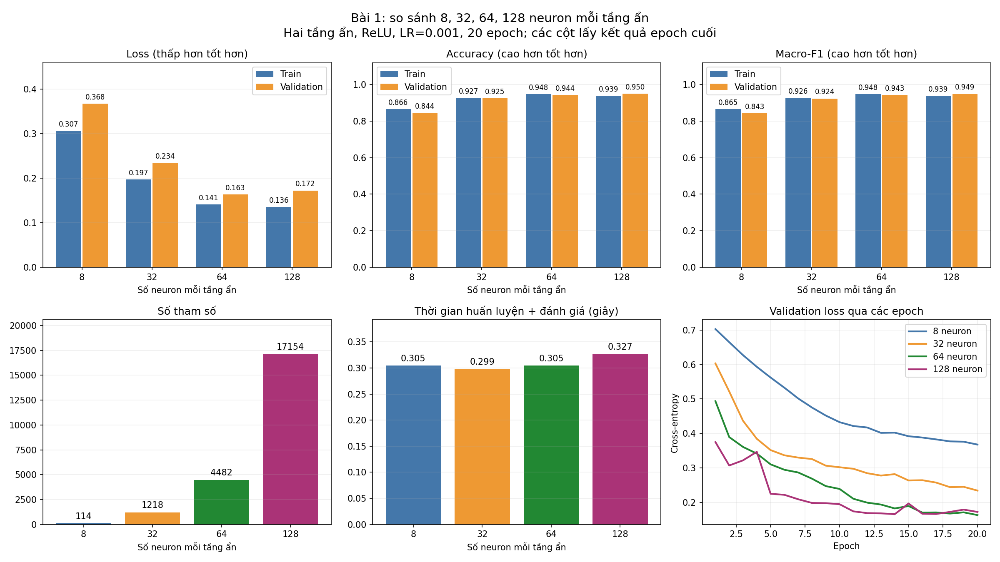
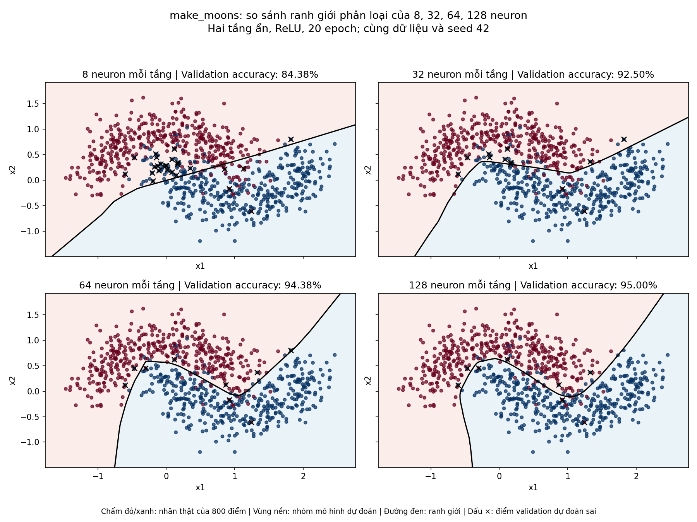

# Kết quả thí nghiệm MLP PyTorch

Dữ liệu: make_moons, n_samples=800, noise=0.25, random_state=42.

Train/validation = 640/160; seed = 42; 20 epoch; batch train = 32; Adam; CrossEntropyLoss. Bảng lấy mô hình ở epoch cuối.

Loss, accuracy và Macro-F1 trong bảng được đo trên validation. Train và validation dùng cùng cách chia random_split như mã gốc, không chuẩn hóa dữ liệu. Không có test riêng, vì vậy đây là kết quả khảo sát trên validation, không phải ước lượng cuối trên tập test độc lập.

Thời gian tính trên CPU gồm học và đo train/validation mỗi epoch; không gồm khởi tạo optimizer, xuất file và vẽ hình. Số tham số gồm trọng số và bias. Loss đo ở chế độ eval, không cộng phạt weight decay; Dropout được tắt lúc đánh giá.

## Bảng so sánh

| Cấu hình | Tầng ẩn | Activation | LR | Dropout | Weight decay | Loss | Accuracy | Macro-F1 | Tham số | Giây |
|---|---|---|---:|---:|---:|---:|---:|---:|---:|---:|
| width8 | 8x8 | relu | 0.001 | 0 | 0 | 0.3678 | 0.8438 | 0.8433 | 114 | 0.30 |
| width32 | 32x32 | relu | 0.001 | 0 | 0 | 0.2343 | 0.9250 | 0.9240 | 1218 | 0.30 |
| width64 | 64x64 | relu | 0.001 | 0 | 0 | 0.1633 | 0.9437 | 0.9426 | 4482 | 0.30 |
| width128 | 128x128 | relu | 0.001 | 0 | 0 | 0.1724 | 0.9500 | 0.9488 | 17154 | 0.33 |

## Nhận xét ngắn

- Cấu hình có validation loss thấp nhất là **width64** (0.1633), accuracy 94.38%, Macro-F1 0.9426.
- Tăng 8 lên 128 neuron mỗi tầng làm tham số tăng từ 114 lên 17154; accuracy thay đổi từ 84.38% thành 95.00%. Mạng rộng có nhiều khả năng biểu diễn hơn nhưng cần nhiều phép tính; không bảo đảm accuracy tăng đều.
- Chưa thấy overfitting rõ theo tiêu chí train loss giảm thêm >0.005 nhưng val loss tăng >0.02 sau epoch có val loss thấp nhất; không nên ép kết luận overfitting khi đường học chưa thể hiện.
- Cả train/validation accuracy cuối đều dưới 90% ở **width8**: có dấu hiệu học chưa đủ tốt. Đây có thể là underfitting hoặc chưa hội tụ; nếu loss vẫn giảm thì 15/20 epoch có thể chưa đủ để kết luận thiếu năng lực mô hình.
- Chỉ chạy seed 42 để sát mã mẫu. Các ngưỡng chẩn đoán là tham khảo; cần đối chiếu learning curve. Không suy rộng kết quả cho mọi dữ liệu hoặc số epoch.

## Biểu đồ

### So sánh trực tiếp số neuron

### Các điểm và ranh giới phân loại

