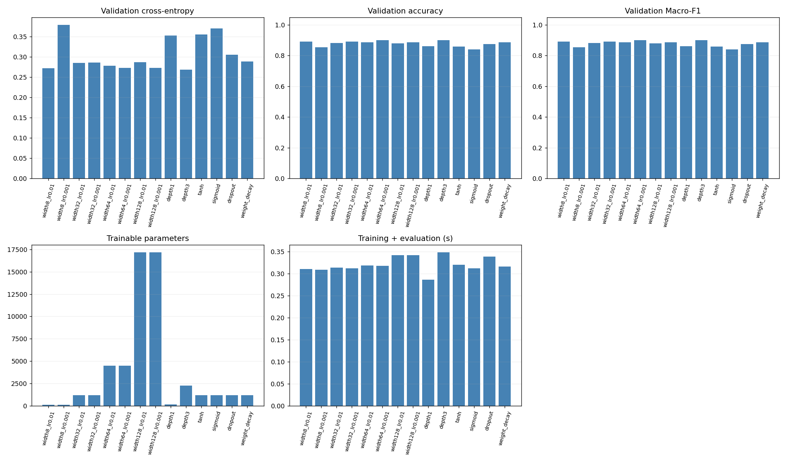
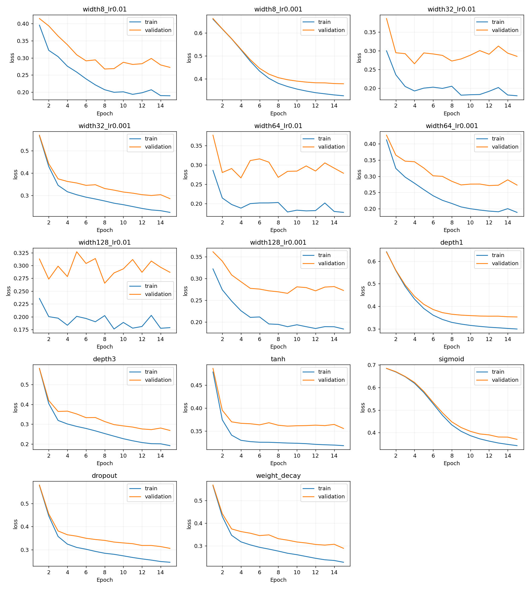
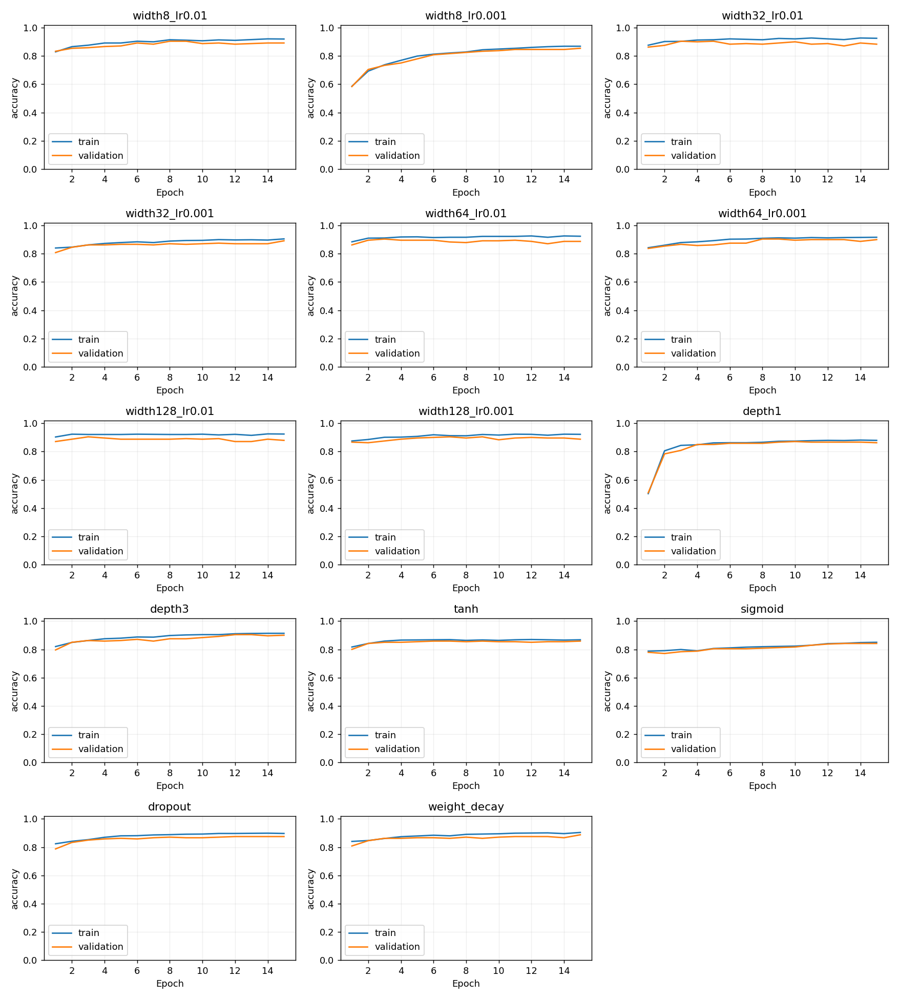

# Kết quả thí nghiệm MLP PyTorch

Dữ liệu: make_moons, n_samples=1200, noise=0.28, random_state=42.

Train/validation = 960/240; seed = 42; 15 epoch; batch train = 32; Adam; CrossEntropyLoss. Bảng lấy mô hình ở epoch cuối.

Loss, accuracy và Macro-F1 trong bảng được đo trên validation. Train và validation dùng cùng cách chia random_split như mã gốc, không chuẩn hóa dữ liệu. Không có test riêng, vì vậy đây là kết quả khảo sát trên validation, không phải ước lượng cuối trên tập test độc lập.

Thời gian tính trên CPU gồm học và đo train/validation mỗi epoch; không gồm khởi tạo optimizer, xuất file và vẽ hình. Số tham số gồm trọng số và bias. Loss đo ở chế độ eval, không cộng phạt weight decay; Dropout được tắt lúc đánh giá.

## Bảng so sánh

| Cấu hình       | Tầng ẩn | Activation |    LR | Dropout | Weight decay |   Loss | Accuracy | Macro-F1 | Tham số | Giây |
| ---------------- | --------- | ---------- | ----: | ------: | -----------: | -----: | -------: | -------: | -------: | ----: |
| width8_lr0.01    | 8x8       | relu       |  0.01 |       0 |            0 | 0.2722 |   0.8917 |   0.8916 |      114 |  0.31 |
| width8_lr0.001   | 8x8       | relu       | 0.001 |       0 |            0 | 0.3790 |   0.8542 |   0.8541 |      114 |  0.31 |
| width32_lr0.01   | 32x32     | relu       |  0.01 |       0 |            0 | 0.2849 |   0.8833 |   0.8832 |     1218 |  0.31 |
| width32_lr0.001  | 32x32     | relu       | 0.001 |       0 |            0 | 0.2863 |   0.8917 |   0.8915 |     1218 |  0.31 |
| width64_lr0.01   | 64x64     | relu       |  0.01 |       0 |            0 | 0.2783 |   0.8875 |   0.8874 |     4482 |  0.32 |
| width64_lr0.001  | 64x64     | relu       | 0.001 |       0 |            0 | 0.2729 |   0.9000 |   0.8999 |     4482 |  0.32 |
| width128_lr0.01  | 128x128   | relu       |  0.01 |       0 |            0 | 0.2867 |   0.8792 |   0.8791 |    17154 |  0.34 |
| width128_lr0.001 | 128x128   | relu       | 0.001 |       0 |            0 | 0.2725 |   0.8875 |   0.8873 |    17154 |  0.34 |
| depth1           | 32        | relu       | 0.001 |       0 |            0 | 0.3525 |   0.8625 |   0.8624 |      162 |  0.29 |
| depth3           | 32x32x32  | relu       | 0.001 |       0 |            0 | 0.2688 |   0.9000 |   0.8999 |     2274 |  0.35 |
| tanh             | 32x32     | tanh       | 0.001 |       0 |            0 | 0.3554 |   0.8583 |   0.8583 |     1218 |  0.32 |
| sigmoid          | 32x32     | sigmoid    | 0.001 |       0 |            0 | 0.3700 |   0.8417 |   0.8417 |     1218 |  0.31 |
| dropout          | 32x32     | relu       | 0.001 |     0.2 |            0 | 0.3057 |   0.8750 |   0.8750 |     1218 |  0.34 |
| weight_decay     | 32x32     | relu       | 0.001 |       0 |       0.0001 | 0.2885 |   0.8875 |   0.8874 |     1218 |  0.32 |

## Nhận xét ngắn

- Cấu hình có validation loss thấp nhất là **depth3** (0.2688), accuracy 90.00%, Macro-F1 0.8999.
- Số tầng ẩn 1/2/3: **depth3** có validation loss thấp nhất nhóm (0.2688).
- Số neuron tại LR=0.001: **width128_lr0.001** có validation loss thấp nhất nhóm (0.2725).
- Activation: **width32_lr0.001** có validation loss thấp nhất nhóm (0.2863).
- Regularization: **width32_lr0.001** có validation loss thấp nhất nhóm (0.2863).
- Khảo sát LR theo mã BTVN gốc: loss trung bình trên bốn độ rộng là 0.2805 với LR=0.01 và 0.3027 với LR=0.001. LR quyết định độ lớn bước cập nhật; kết luận phụ thuộc ngân sách 15 epoch.
- Dấu hiệu overfitting ở **width128_lr0.01**: sau epoch có val loss thấp nhất, train loss giảm thêm >0.005 nhưng val loss tăng >0.02.
- Cả train/validation accuracy cuối đều dưới 90% ở **width8_lr0.001, depth1, tanh, sigmoid, dropout**: có dấu hiệu học chưa đủ tốt. Đây có thể là underfitting hoặc chưa hội tụ; nếu loss vẫn giảm thì 15/20 epoch có thể chưa đủ để kết luận thiếu năng lực mô hình.
- Chỉ chạy seed 42 để sát mã mẫu. Các ngưỡng chẩn đoán là tham khảo; cần đối chiếu learning curve. Không suy rộng kết quả cho mọi dữ liệu hoặc số epoch.

## Biểu đồ

