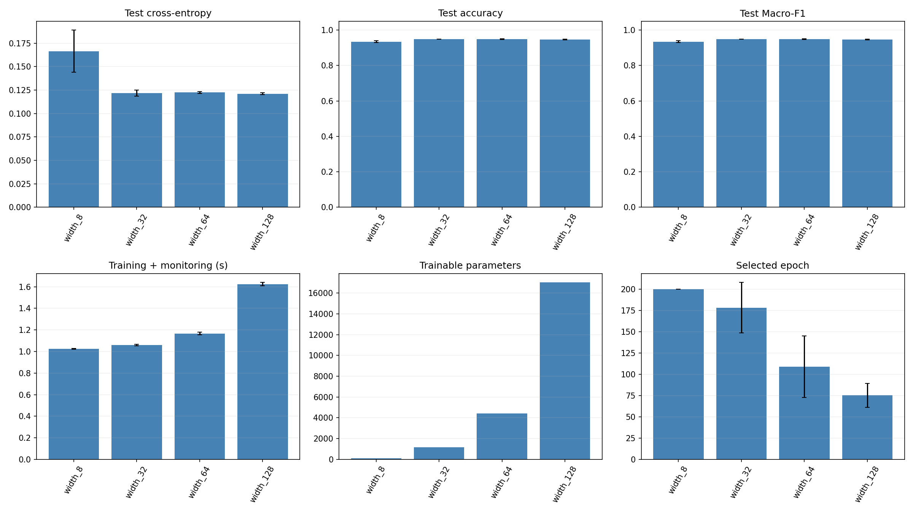
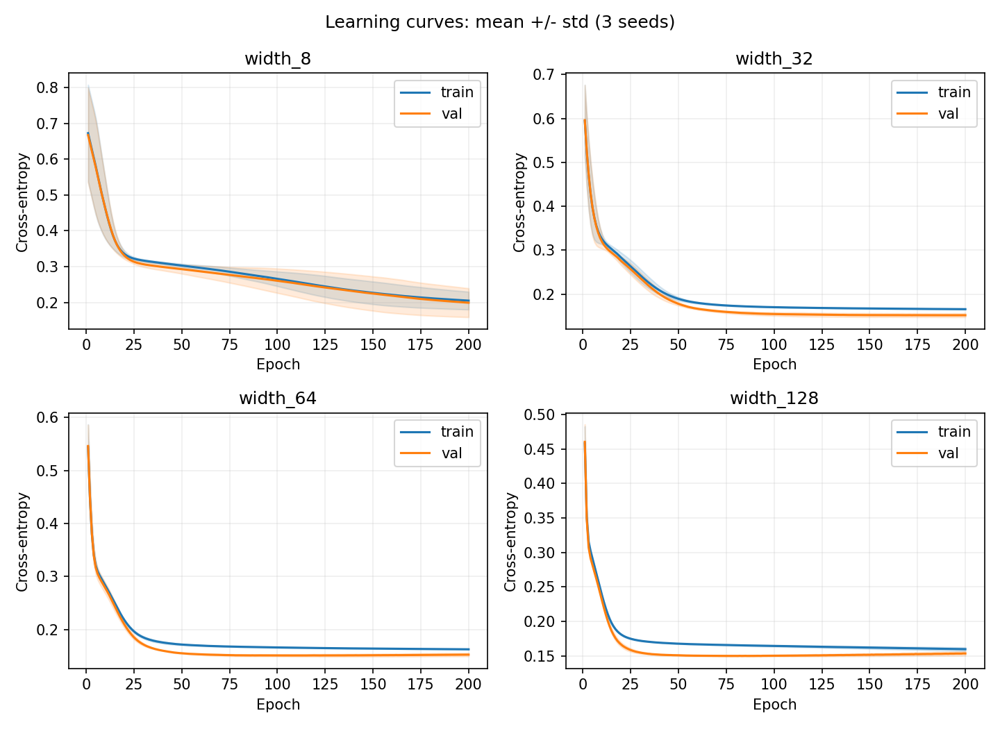
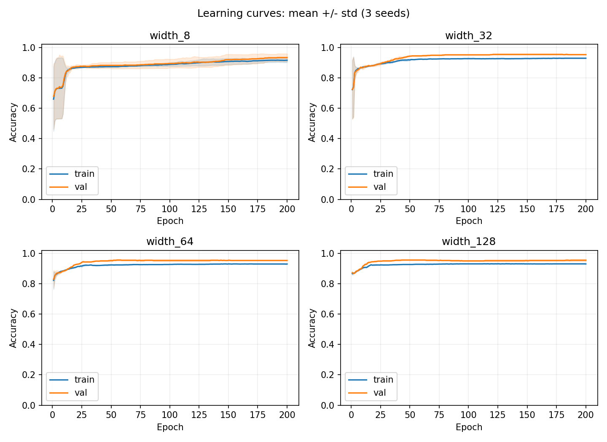
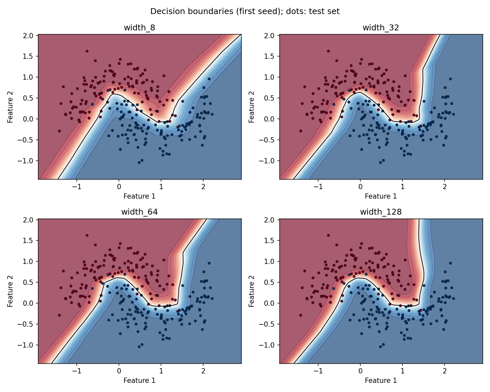

# Bài 1 – Ảnh hưởng của số neuron

Dữ liệu: **make_moons (1.200 mẫu, noise=0.25)**.

Train/validation/test: **720/240/240** mẫu, chia phân tầng, seed chia dữ liệu = 42. StandardScaler chỉ học từ train.

Adam, learning rate = 0.001, batch size = 64, 200 epoch, seed mô hình = [42, 43, 44]. Mỗi cấu hình chạy đủ số epoch; checkpoint được chọn theo validation cross-entropy thấp nhất rồi mới đánh giá test. Cùng seed được dùng lại cho từng cấu hình để kiểm soát ngẫu nhiên.

Loss là cross-entropy không gồm L2; accuracy và Macro-F1 nằm trong [0, 1]. Số tham số tính cả trọng số và bias. Thời gian gồm huấn luyện, đo train/validation và lưu checkpoint trong RAM, không gồm vẽ biểu đồ hoặc đánh giá test. BLAS dùng một luồng; thời gian còn phụ thuộc máy và tải hệ thống. Bảng ghi trung bình ± độ lệch chuẩn mẫu giữa các seed trên cùng một lần chia dữ liệu.

MLP dùng sigmoid ở đầu ra khi phân loại nhị phân và softmax khi nhiều lớp. Các activation trong bảng là activation của tầng ẩn. L2 (`alpha`) cộng hạng phạt trọng số vào mục tiêu huấn luyện, được scikit-learn chuẩn hóa theo số mẫu của batch; đây không phải decoupled weight decay của AdamW.

## Bảng so sánh

| Cấu hình | Tầng ẩn | Activation | L2 alpha | Tham số | Val loss | Test loss | Test accuracy | Test Macro-F1 | Giây | Epoch chọn |
|---|---|---|---:|---:|---:|---:|---:|---:|---:|---:|
| width_8 | 8x8 | relu | 0 | 105 | 0.1992 ± 0.0403 | 0.1664 ± 0.0225 | 0.9347 ± 0.0048 | 0.9347 ± 0.0048 | 1.03 ± 0.00 | 200.0 ± 0.0 |
| width_32 | 32x32 | relu | 0 | 1185 | 0.1516 ± 0.0043 | 0.1217 ± 0.0031 | 0.9500 ± 0.0000 | 0.9500 ± 0.0000 | 1.06 ± 0.01 | 178.3 ± 29.8 |
| width_64 | 64x64 | relu | 0 | 4417 | 0.1506 ± 0.0022 | 0.1224 ± 0.0011 | 0.9486 ± 0.0024 | 0.9486 ± 0.0024 | 1.17 ± 0.01 | 109.0 ± 36.3 |
| width_128 | 128x128 | relu | 0 | 17025 | 0.1499 ± 0.0010 | 0.1210 ± 0.0011 | 0.9472 ± 0.0024 | 0.9472 ± 0.0024 | 1.62 ± 0.02 | 75.3 ± 14.0 |

## Nhận xét ngắn

- Theo validation loss trung bình, **width_128** tốt nhất (0.1499); checkpoint của cấu hình này có test accuracy 94.72%, Macro-F1 0.9472. Dùng validation để chọn cấu hình; test chỉ dùng báo cáo đánh giá cuối.
- Từ 8 lên 128 neuron mỗi tầng, số tham số tăng từ 105 lên 17025 (162.1 lần); test accuracy thay đổi từ 93.47% thành 94.72%, thời gian từ 1.03s thành 1.62s. Nhiều neuron tăng khả năng biểu diễn và chi phí; chất lượng còn phụ thuộc nhiễu và tối ưu, không bảo đảm tăng đều theo độ rộng.
- Chưa thấy dấu hiệu overfitting rõ theo tiêu chí: train loss cuối giảm thêm >0.005 trong khi val loss tăng >0.02 so với checkpoint tốt nhất. Khoảng cách train/validation nhỏ không đủ để khẳng định không overfit.
- Không cấu hình nào có cả accuracy train/validation cuối dưới 90%. Không có bằng chứng underfitting rõ theo ngưỡng tham khảo này; hãy đối chiếu learning curve thay vì chỉ nhìn test accuracy.
- Các seed chỉ phản ánh biến động khởi tạo và thứ tự batch; chưa đo độ bất định giữa nhiều lần chia dữ liệu. Các ngưỡng chẩn đoán trên là quy ước tham khảo, không phải kiểm định thống kê.

## Biểu đồ

## Dữ liệu kết quả

- `summary.csv`: bảng trung bình và độ lệch chuẩn.
- `runs.csv`: kết quả từng cấu hình và seed tại checkpoint đã chọn.
- `history.csv`: train/validation loss, accuracy và Macro-F1 mỗi epoch.
- `metadata.json`: cấu hình chạy, cách chia dữ liệu và phiên bản thư viện.
