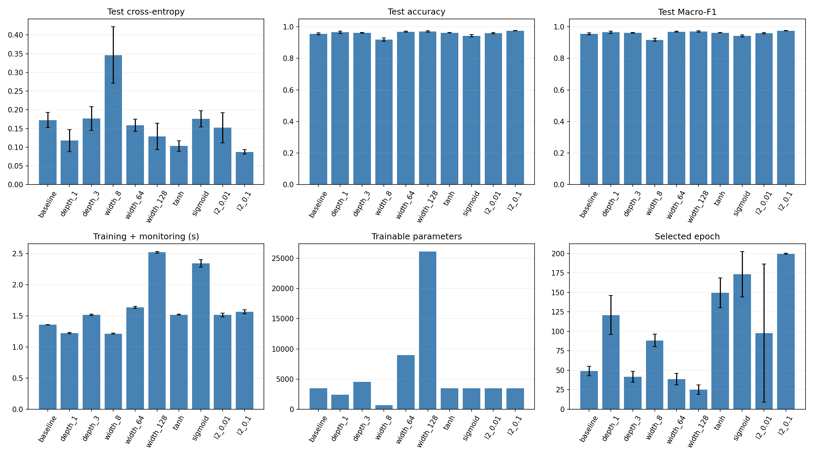
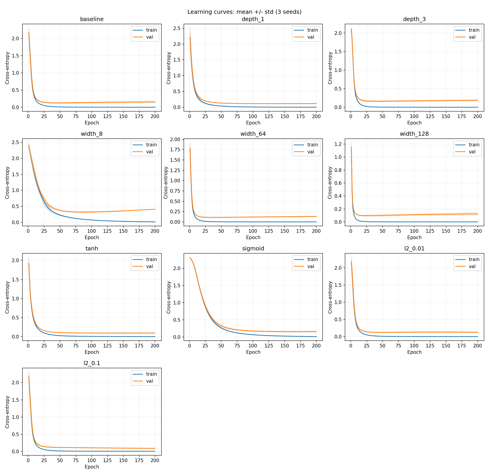
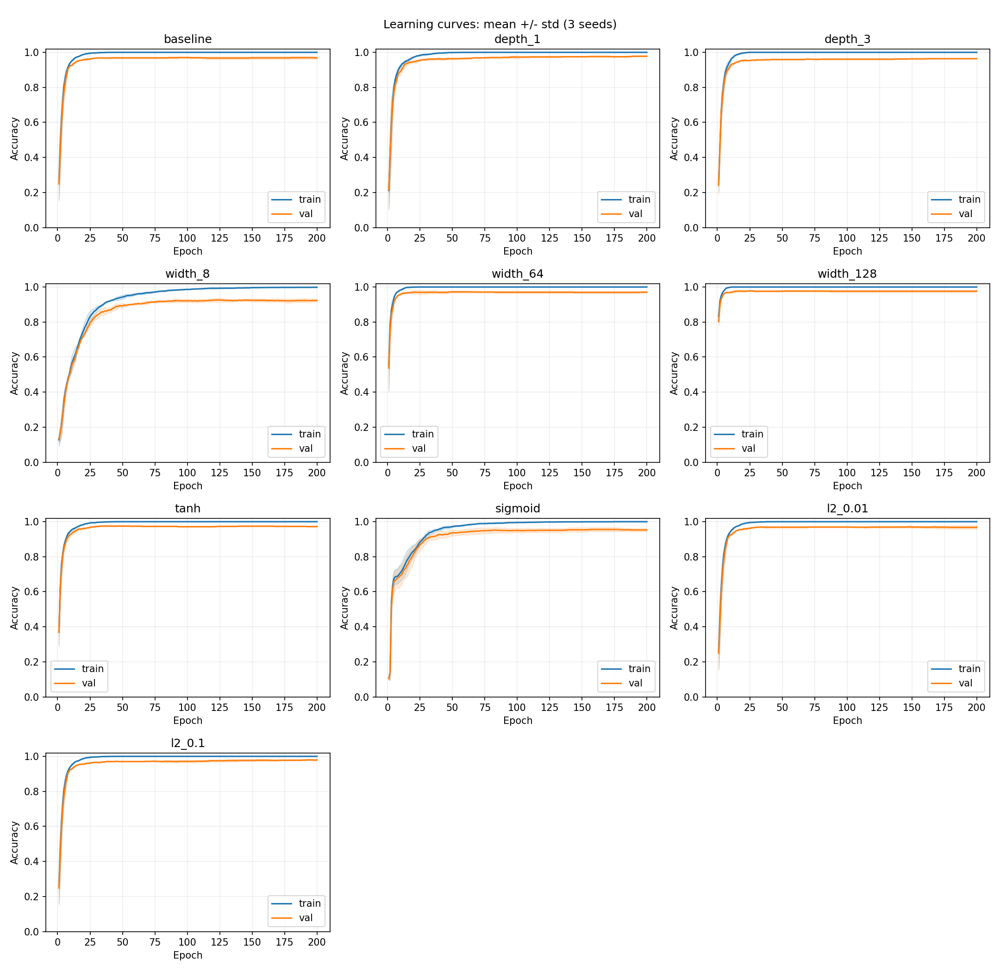

# Bài 2 – Khảo sát kiến trúc và regularization

Dữ liệu: **digits (1.797 mẫu, 64 đặc trưng, 10 lớp)**.

Train/validation/test: **1078/359/360** mẫu, chia phân tầng, seed chia dữ liệu = 42. StandardScaler chỉ học từ train.

Adam, learning rate = 0.001, batch size = 64, 200 epoch, seed mô hình = [42, 43, 44]. Mỗi cấu hình chạy đủ số epoch; checkpoint được chọn theo validation cross-entropy thấp nhất rồi mới đánh giá test. Cùng seed được dùng lại cho từng cấu hình để kiểm soát ngẫu nhiên.

Loss là cross-entropy không gồm L2; accuracy và Macro-F1 nằm trong [0, 1]. Số tham số tính cả trọng số và bias. Thời gian gồm huấn luyện, đo train/validation và lưu checkpoint trong RAM, không gồm vẽ biểu đồ hoặc đánh giá test. BLAS dùng một luồng; thời gian còn phụ thuộc máy và tải hệ thống. Bảng ghi trung bình ± độ lệch chuẩn mẫu giữa các seed trên cùng một lần chia dữ liệu.

MLP dùng sigmoid ở đầu ra khi phân loại nhị phân và softmax khi nhiều lớp. Các activation trong bảng là activation của tầng ẩn. L2 (`alpha`) cộng hạng phạt trọng số vào mục tiêu huấn luyện, được scikit-learn chuẩn hóa theo số mẫu của batch; đây không phải decoupled weight decay của AdamW.

## Bảng so sánh

| Cấu hình | Tầng ẩn | Activation | L2 alpha | Tham số | Val loss | Test loss | Test accuracy | Test Macro-F1 | Giây | Epoch chọn |
|---|---|---|---:|---:|---:|---:|---:|---:|---:|---:|
| baseline | 32x32 | relu | 0 | 3466 | 0.1253 ± 0.0146 | 0.1724 ± 0.0203 | 0.9565 ± 0.0064 | 0.9563 ± 0.0066 | 1.36 ± 0.00 | 49.0 ± 6.0 |
| depth_1 | 32 | relu | 0 | 2410 | 0.1148 ± 0.0081 | 0.1176 ± 0.0297 | 0.9657 ± 0.0070 | 0.9655 ± 0.0070 | 1.22 ± 0.01 | 121.0 ± 25.1 |
| depth_3 | 32x32x32 | relu | 0 | 4522 | 0.1606 ± 0.0204 | 0.1766 ± 0.0314 | 0.9620 ± 0.0016 | 0.9618 ± 0.0015 | 1.51 ± 0.01 | 41.7 ± 7.0 |
| width_8 | 8x8 | relu | 0 | 682 | 0.3184 ± 0.0197 | 0.3464 ± 0.0754 | 0.9185 ± 0.0112 | 0.9176 ± 0.0101 | 1.21 ± 0.01 | 88.3 ± 8.1 |
| width_64 | 64x64 | relu | 0 | 8970 | 0.1095 ± 0.0096 | 0.1586 ± 0.0162 | 0.9694 ± 0.0028 | 0.9693 ± 0.0028 | 1.63 ± 0.02 | 38.7 ± 7.2 |
| width_128 | 128x128 | relu | 0 | 26122 | 0.0960 ± 0.0109 | 0.1288 ± 0.0352 | 0.9704 ± 0.0042 | 0.9702 ± 0.0044 | 2.52 ± 0.01 | 25.3 ± 6.0 |
| tanh | 32x32 | tanh | 0 | 3466 | 0.0938 ± 0.0102 | 0.1030 ± 0.0141 | 0.9630 ± 0.0016 | 0.9627 ± 0.0016 | 1.52 ± 0.01 | 149.3 ± 19.1 |
| sigmoid | 32x32 | sigmoid | 0 | 3466 | 0.1544 ± 0.0201 | 0.1759 ± 0.0213 | 0.9435 ± 0.0070 | 0.9427 ± 0.0071 | 2.34 ± 0.06 | 173.3 ± 29.1 |
| l2_0.01 | 32x32 | relu | 0.01 | 3466 | 0.1206 ± 0.0118 | 0.1519 ± 0.0399 | 0.9593 ± 0.0042 | 0.9591 ± 0.0044 | 1.51 ± 0.03 | 97.7 ± 88.7 |
| l2_0.1 | 32x32 | relu | 0.1 | 3466 | 0.0928 ± 0.0085 | 0.0872 ± 0.0059 | 0.9759 ± 0.0016 | 0.9758 ± 0.0017 | 1.56 ± 0.03 | 199.7 ± 0.6 |

## Nhận xét ngắn

- Theo validation loss trung bình, **l2_0.1** tốt nhất (0.0928); checkpoint của cấu hình này có test accuracy 97.59%, Macro-F1 0.9758. Dùng validation để chọn cấu hình; test chỉ dùng báo cáo đánh giá cuối.
- Baseline 2×32 ReLU: val loss 0.1253, test accuracy 95.65%. Các nhóm depth, width, activation và L2 chỉ thay một yếu tố so với baseline; so sánh validation loss và learning curve để đánh giá từng thay đổi.
- Số tầng ẩn (1/2/3): **depth_1** có val loss thấp nhất nhóm (0.1148). Kết quả chỉ áp dụng cho dữ liệu, learning rate và ngân sách epoch của thí nghiệm này.
- Số neuron (8/32/64/128): **width_128** có val loss thấp nhất nhóm (0.0960). Kết quả chỉ áp dụng cho dữ liệu, learning rate và ngân sách epoch của thí nghiệm này.
- Activation (ReLU/tanh/sigmoid): **tanh** có val loss thấp nhất nhóm (0.0938). Kết quả chỉ áp dụng cho dữ liệu, learning rate và ngân sách epoch của thí nghiệm này.
- L2 (alpha = 0/0.01/0.1): **l2_0.1** có val loss thấp nhất nhóm (0.0928). Kết quả chỉ áp dụng cho dữ liệu, learning rate và ngân sách epoch của thí nghiệm này.
- Dấu hiệu overfitting ở **baseline, depth_3, width_8, width_64**: sau checkpoint tốt nhất, train loss cuối giảm thêm trên 0.005 nhưng val loss cuối tăng trên 0.02. Chọn checkpoint sớm giúp hạn chế giảm chất lượng; đối chiếu đường loss và khoảng cách accuracy train/validation.
- Không cấu hình nào có cả accuracy train/validation cuối dưới 90%. Không có bằng chứng underfitting rõ theo ngưỡng tham khảo này; hãy đối chiếu learning curve thay vì chỉ nhìn test accuracy.
- Các seed chỉ phản ánh biến động khởi tạo và thứ tự batch; chưa đo độ bất định giữa nhiều lần chia dữ liệu. Các ngưỡng chẩn đoán trên là quy ước tham khảo, không phải kiểm định thống kê.

## Biểu đồ

## Dữ liệu kết quả

- `summary.csv`: bảng trung bình và độ lệch chuẩn.
- `runs.csv`: kết quả từng cấu hình và seed tại checkpoint đã chọn.
- `history.csv`: train/validation loss, accuracy và Macro-F1 mỗi epoch.
- `metadata.json`: cấu hình chạy, cách chia dữ liệu và phiên bản thư viện.
