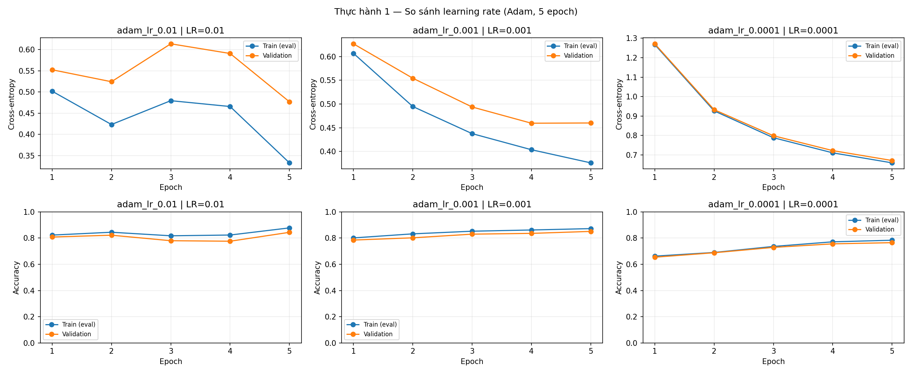
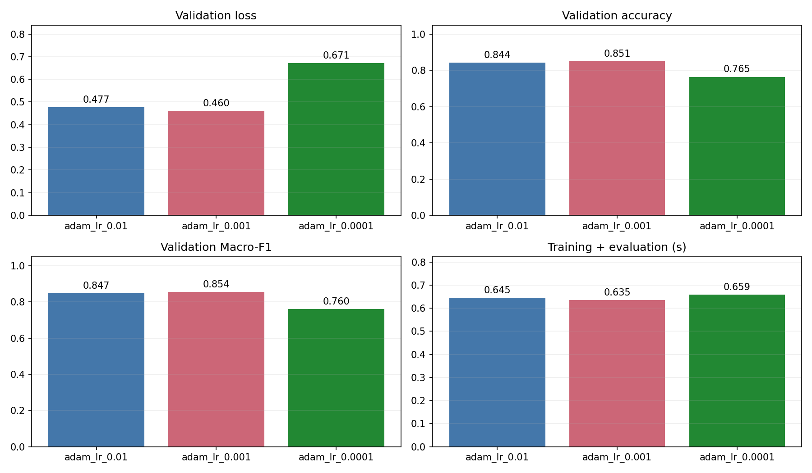
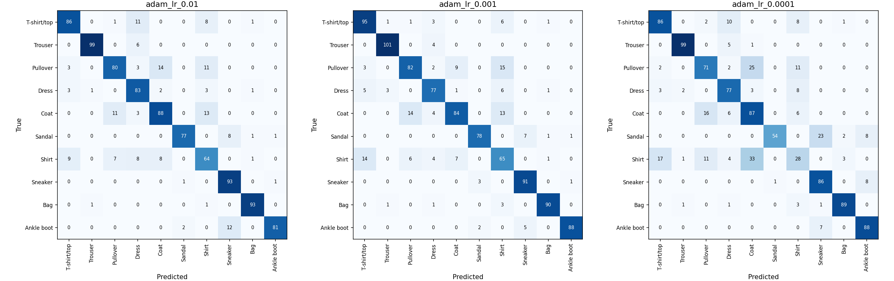
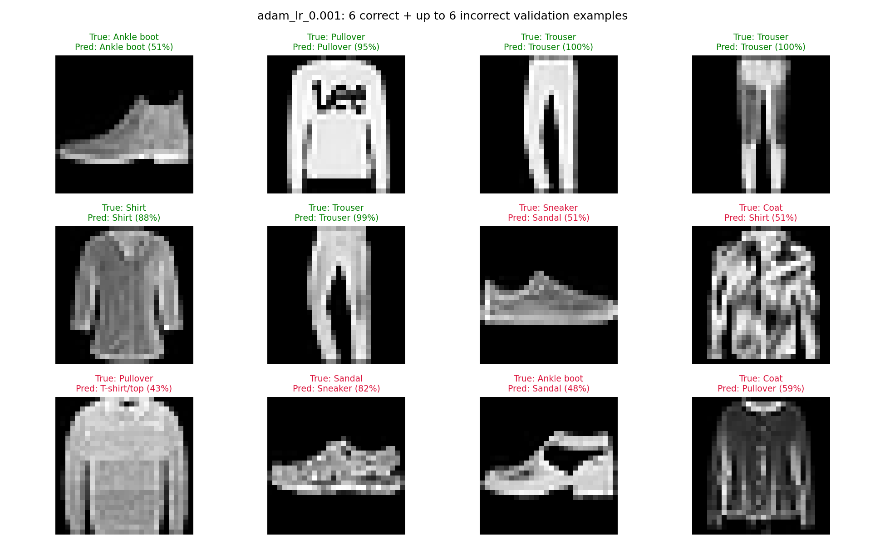

# Thực hành 1 — So sánh learning rate (Adam, 5 epoch)

Người làm: **Lê Sơn Trường**.

Fashion-MNIST; train/validation = 6000/1000; MLP 784 → 256 → 10, ReLU; seed42; 5 epoch tối đa. Batch train=64, validation=256; CPU, 2 threads.

Train loss/accuracy trên learning curve được đo lại ở cuối epoch bằng eval, cùng cách với validation. online_train_loss là loss trung bình có trọng số của các batch trong lúc cập nhật; hai đại lượng có thể khác nhau.

| Cấu hình | LR | Momentum | Epoch chạy/chọn | Train loss | Val loss | Val accuracy | Macro-F1 | Giây |
|---|---:|---:|---:|---:|---:|---:|---:|---:|
| adam_lr_0.01 | 0.01 | 0 | 5/5 | 0.3328 | 0.4770 | 84.40% | 0.8472 | 0.64 |
| adam_lr_0.001 | 0.001 | 0 | 5/5 | 0.3761 | 0.4601 | 85.10% | 0.8544 | 0.63 |
| adam_lr_0.0001 | 0.0001 | 0 | 5/5 | 0.6589 | 0.6710 | 76.50% | 0.7603 | 0.66 |

## Kết quả sau từng epoch

| Cấu hình | Epoch | Device | Số tham số | Train loss | Val loss | Val accuracy |
|---|---:|---|---:|---:|---:|---:|
| adam_lr_0.01 | 1 | cpu | 203,530 | 0.5020 | 0.5526 | 80.80% |
| adam_lr_0.01 | 2 | cpu | 203,530 | 0.4233 | 0.5244 | 82.20% |
| adam_lr_0.01 | 3 | cpu | 203,530 | 0.4796 | 0.6139 | 78.00% |
| adam_lr_0.01 | 4 | cpu | 203,530 | 0.4658 | 0.5910 | 77.60% |
| adam_lr_0.01 | 5 | cpu | 203,530 | 0.3328 | 0.4770 | 84.40% |
| adam_lr_0.001 | 1 | cpu | 203,530 | 0.6067 | 0.6267 | 78.50% |
| adam_lr_0.001 | 2 | cpu | 203,530 | 0.4947 | 0.5543 | 80.20% |
| adam_lr_0.001 | 3 | cpu | 203,530 | 0.4377 | 0.4937 | 83.00% |
| adam_lr_0.001 | 4 | cpu | 203,530 | 0.4037 | 0.4595 | 83.60% |
| adam_lr_0.001 | 5 | cpu | 203,530 | 0.3761 | 0.4601 | 85.10% |
| adam_lr_0.0001 | 1 | cpu | 203,530 | 1.2677 | 1.2715 | 65.40% |
| adam_lr_0.0001 | 2 | cpu | 203,530 | 0.9265 | 0.9326 | 68.80% |
| adam_lr_0.0001 | 3 | cpu | 203,530 | 0.7883 | 0.7985 | 72.90% |
| adam_lr_0.0001 | 4 | cpu | 203,530 | 0.7105 | 0.7220 | 75.60% |
| adam_lr_0.0001 | 5 | cpu | 203,530 | 0.6589 | 0.6710 | 76.50% |

## Nhận xét từ kết quả chạy

- **adam_lr_0.001** có validation loss thấp nhất: **0.4601**. Accuracy cao nhất thuộc **adam_lr_0.001**: **85.10%**.
- LR=0.01: validation loss epoch 1 → 5 là 0.5526 → 0.4770; accuracy 80.80% → 84.40%.
- LR=0.001: validation loss epoch 1 → 5 là 0.6267 → 0.4601; accuracy 78.50% → 85.10%.
- LR=0.0001: validation loss epoch 1 → 5 là 1.2715 → 0.6710; accuracy 65.40% → 76.50%.
- LR quyết định độ lớn bước cập nhật. LR lớn có thể học nhanh hoặc dao động; LR nhỏ có thể chưa hội tụ sau 5 epoch. Đối chiếu các đường thực đo, không mặc định LR lớn luôn kém hay LR nhỏ luôn tốt.
- Bảng cơ bản lấy **epoch cuối**, không chọn lại epoch có điểm đẹp hơn.
- Tất cả cấu hình trong mỗi bài dùng cùng trọng số khởi tạo và cùng thứ tự mini-batch. Số tham số gồm weight và bias; thời gian gồm huấn luyện và đánh giá mỗi epoch, không gồm đọc dữ liệu, khởi tạo hay vẽ biểu đồ.
- Giữ split của mã gốc: validation lấy từ test chính thức. Sau khi dùng để so sánh LR/optimizer, không xem đây là điểm test độc lập. Chỉ một seed và 5 epoch nên kết luận có phạm vi giới hạn.
- Nếu loss không giảm: kiểm tra chuẩn hóa /255, nhãn long, logits thô cho CE, zero_grad/backward/step và LR. Nếu train tốt nhưng val kém: cân nhắc giảm capacity, regularization hoặc thêm dữ liệu trong thí nghiệm mở rộng có ghi rõ cấu hình.

