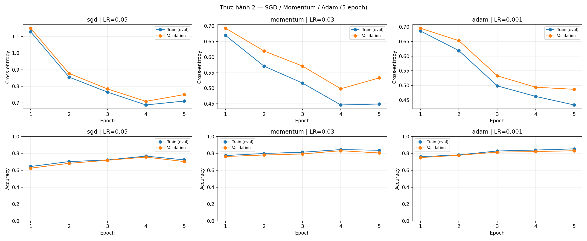
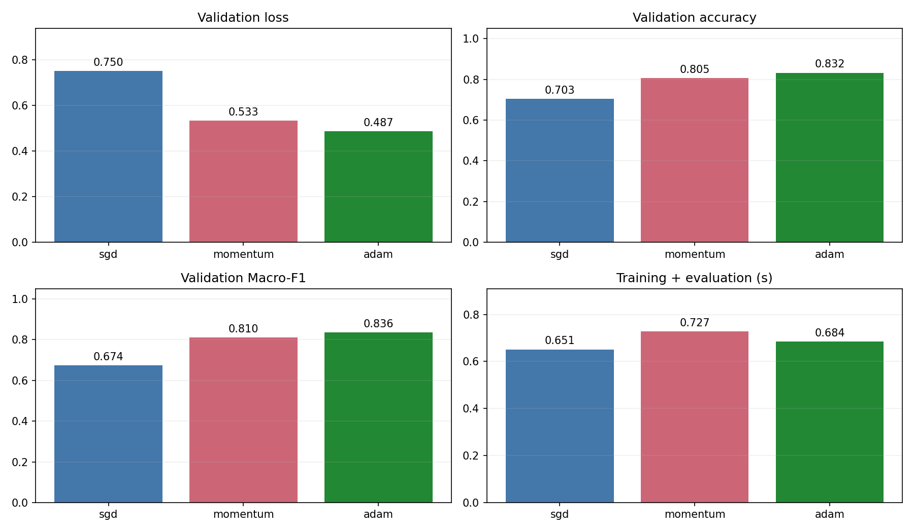
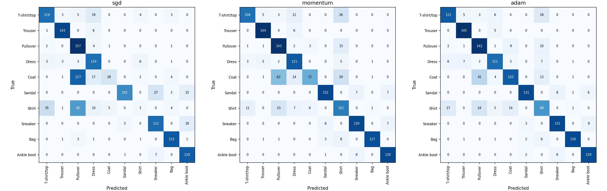
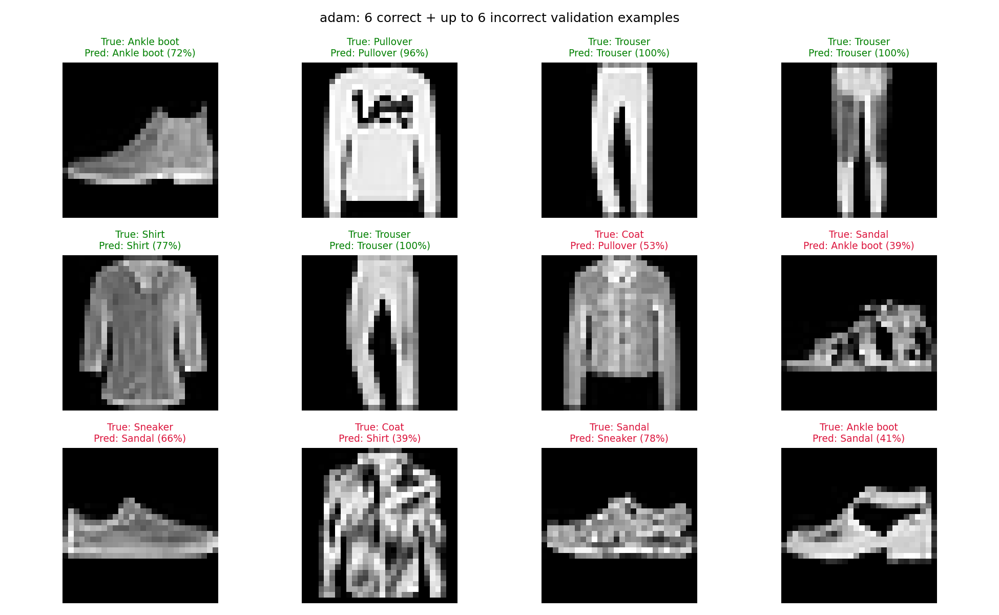

# Thực hành 2 — SGD / Momentum / Adam (5 epoch)

Người làm: **Lê Sơn Trường**.

Fashion-MNIST; train/validation = 8000/1500; MLP 784 → 128 → 10, ReLU; seed42; 5 epoch tối đa. Batch train=128, validation=256; CPU, 2 threads.

Train loss/accuracy trên learning curve được đo lại ở cuối epoch bằng eval, cùng cách với validation. online_train_loss là loss trung bình có trọng số của các batch trong lúc cập nhật; hai đại lượng có thể khác nhau.

| Cấu hình | LR | Momentum | Epoch chạy/chọn | Train loss | Val loss | Val accuracy | Macro-F1 | Giây |
|---|---:|---:|---:|---:|---:|---:|---:|---:|
| sgd | 0.05 | 0 | 5/5 | 0.7112 | 0.7501 | 70.33% | 0.6740 | 0.65 |
| momentum | 0.03 | 0.9 | 5/5 | 0.4492 | 0.5332 | 80.53% | 0.8097 | 0.73 |
| adam | 0.001 | 0 | 5/5 | 0.4331 | 0.4867 | 83.20% | 0.8360 | 0.68 |

## Kết quả sau từng epoch

| Cấu hình | Epoch | Device | Số tham số | Train loss | Val loss | Val accuracy |
|---|---:|---|---:|---:|---:|---:|
| sgd | 1 | cpu | 101,770 | 1.1285 | 1.1493 | 62.53% |
| sgd | 2 | cpu | 101,770 | 0.8554 | 0.8777 | 68.27% |
| sgd | 3 | cpu | 101,770 | 0.7652 | 0.7842 | 71.87% |
| sgd | 4 | cpu | 101,770 | 0.6877 | 0.7095 | 75.67% |
| sgd | 5 | cpu | 101,770 | 0.7112 | 0.7501 | 70.33% |
| momentum | 1 | cpu | 101,770 | 0.6697 | 0.6928 | 76.33% |
| momentum | 2 | cpu | 101,770 | 0.5711 | 0.6197 | 78.13% |
| momentum | 3 | cpu | 101,770 | 0.5168 | 0.5713 | 79.33% |
| momentum | 4 | cpu | 101,770 | 0.4462 | 0.4982 | 83.20% |
| momentum | 5 | cpu | 101,770 | 0.4492 | 0.5332 | 80.53% |
| adam | 1 | cpu | 101,770 | 0.6861 | 0.6955 | 75.07% |
| adam | 2 | cpu | 101,770 | 0.6188 | 0.6529 | 77.80% |
| adam | 3 | cpu | 101,770 | 0.4984 | 0.5328 | 81.53% |
| adam | 4 | cpu | 101,770 | 0.4622 | 0.4937 | 82.20% |
| adam | 5 | cpu | 101,770 | 0.4331 | 0.4867 | 83.20% |

## Nhận xét từ kết quả chạy

- **adam** có validation loss thấp nhất: **0.4867**. Accuracy cao nhất thuộc **adam**: **83.20%**.
- SGD cập nhật trực tiếp theo gradient, ít trạng thái nhưng nhạy với LR; Momentum tích lũy hướng cập nhật, có thể giảm dao động; Adam dùng trung bình gradient và bình phương gradient để điều chỉnh bước cho từng tham số.
- LR của ba optimizer khác nhau đúng theo mã mẫu (.05/.03/.001). Đây là so sánh ba cấu hình được giao, chưa tách riêng ảnh hưởng của optimizer và chưa tìm siêu tham số tốt nhất cho từng thuật toán.
- sgd, epoch 4 → 5: train loss 0.6877 → 0.7112 và val loss 0.7095 → 0.7501 cùng tăng. Đây có thể là dao động cập nhật do LR/mini-batch; chưa đủ để kết luận overfitting. Có thể thử giảm LR trong khảo sát riêng, giữ bảng chính đúng cấu hình đề.
- momentum, epoch 4 → 5: train loss 0.4462 → 0.4492 và val loss 0.4982 → 0.5332 cùng tăng. Đây có thể là dao động cập nhật do LR/mini-batch; chưa đủ để kết luận overfitting. Có thể thử giảm LR trong khảo sát riêng, giữ bảng chính đúng cấu hình đề.
- Bảng cơ bản lấy **epoch cuối**, không chọn lại epoch có điểm đẹp hơn.
- Tất cả cấu hình trong mỗi bài dùng cùng trọng số khởi tạo và cùng thứ tự mini-batch. Số tham số gồm weight và bias; thời gian gồm huấn luyện và đánh giá mỗi epoch, không gồm đọc dữ liệu, khởi tạo hay vẽ biểu đồ.
- Giữ split của mã gốc: validation lấy từ test chính thức. Sau khi dùng để so sánh LR/optimizer, không xem đây là điểm test độc lập. Chỉ một seed và 5 epoch nên kết luận có phạm vi giới hạn.
- Nếu loss không giảm: kiểm tra chuẩn hóa /255, nhãn long, logits thô cho CE, zero_grad/backward/step và LR. Nếu train tốt nhưng val kém: cân nhắc giảm capacity, regularization hoặc thêm dữ liệu trong thí nghiệm mở rộng có ghi rõ cấu hình.

