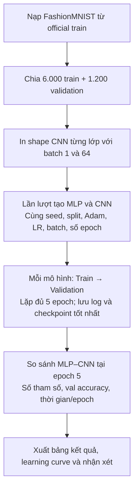
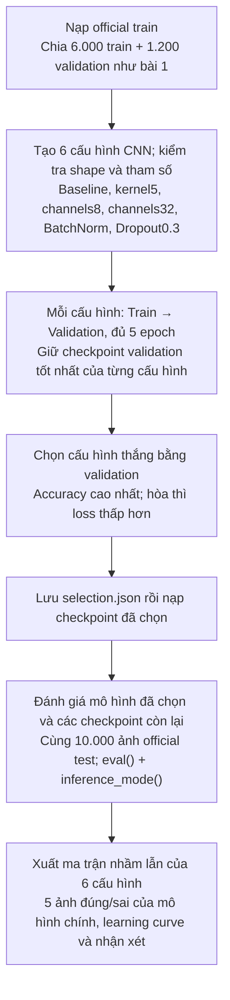
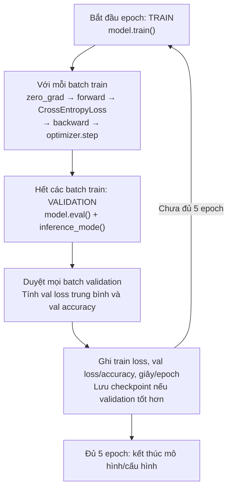

# Quy trình chạy hai bài CNN — Buổi 4

**Sinh viên: Lê Sơn Trường.** Tài liệu mô tả cách thao tác và thứ tự xử lý trong code.

## 1. Chuẩn bị và thứ tự thao tác

1. Mở repository **DeepL** trong VS Code. Giữ các notebook, script, `common.py`,
   `reporting.py` và `build_notebooks.py` cùng thư mục `Buoi4/`.
2. Mở notebook bài 1, bấm **Select Kernel → DeepL (PyTorch)**. Cell thiết lập
   in đường dẫn Python và CPU/GPU để kiểm tra môi trường đang dùng.
3. Chọn **Run All** để chạy từ trên xuống. Cell `exercise.main()` mới bắt đầu
   huấn luyện; các cell `display(Code(...))` chỉ hiển thị mã để đọc.
4. Xem nhật ký shape, kết quả từng epoch, bảng MLP–CNN và learning curve.
5. Mở notebook bài 2, chọn cùng kernel và **Run All**. Đọc bảng cấu hình,
   checkpoint được chọn bằng validation, rồi kết quả test và ảnh dự đoán.
6. Đối chiếu kết quả bằng `verify_results.py`, sau đó mở `BAO_CAO_BUOI4.md`
   bằng Markdown Preview để đọc báo cáo tổng hợp.

Notebook có sẵn output nên có thể đọc ngay. **Run All sẽ học lại thực sự**;
chạy lại chỉ từ một cell giữa notebook có thể thiếu biến hoặc giữ mã cũ trong kernel.
Nếu vừa cập nhật file, mở lại notebook rồi **Restart Kernel → Run All**.

## 2. Chạy bằng terminal

Đứng ở thư mục gốc repository **DeepL**, chạy lần lượt:

```powershell
# Bài 1: MLP và CNN
& .\Buoi1\Buoi1_PyTorch\.venv\Scripts\python.exe Buoi4/bai03_class_cnn_fashionmnist.py
# Bài 2: các biến thể CNN, chọn bằng validation, đánh giá test
& .\Buoi1\Buoi1_PyTorch\.venv\Scripts\python.exe Buoi4/bai03_homework_cnn_variants.py
# Chỉ bổ sung/cập nhật ma trận cả 6 cấu hình từ checkpoint đã có
& .\Buoi1\Buoi1_PyTorch\.venv\Scripts\python.exe Buoi4/bai03_homework_cnn_variants.py --evaluate-only
# Kiểm tra split, checkpoint, dự đoán và confusion matrix
& .\Buoi1\Buoi1_PyTorch\.venv\Scripts\python.exe Buoi4/verify_results.py
# Cập nhật báo cáo từ các kết quả vừa chạy, không huấn luyện lại
& .\Buoi1\Buoi1_PyTorch\.venv\Scripts\python.exe Buoi4/build_notebooks.py --report-only
```

Chạy script cập nhật `results/` và báo cáo, nhưng không tự thay output đã lưu
trong notebook. Để chạy lại và đồng bộ cả hai notebook cùng báo cáo:

```powershell
& .\Buoi1\Buoi1_PyTorch\.venv\Scripts\python.exe Buoi4/build_notebooks.py --execute
```

Sau khi dùng `--evaluate-only`, đồng bộ phần hiển thị notebook từ kết quả đã lưu:

```powershell
& .\Buoi1\Buoi1_PyTorch\.venv\Scripts\python.exe Buoi4/build_notebooks.py --refresh
```

`--refresh` chạy các cell hiển thị, dùng lại output huấn luyện trước đó và bỏ qua
`exercise.main()`. Chạy **Run All** bình thường trong notebook vẫn huấn luyện lại.

Nếu chuyển sang máy khác, dùng Python có các thư viện trong `requirements.txt`
và chọn đúng môi trường đó làm kernel. Dữ liệu được dùng lại từ cache nếu có;
nếu chưa có, code tải Fashion-MNIST chính thức và kiểm SHA-256.

## Quy trình chạy — Thực hành 1: so sánh MLP–CNN


<details>
<summary>Mã Mermaid để chỉnh sửa sơ đồ</summary>



</details>


**Luồng đọc nhanh:**

```text
Nạp official train → Chia 6000 train / 1200 validation
→ In shape → Lần lượt tạo MLP và CNN cùng optimizer
→ Với mỗi mô hình: 5 × [Train 1 epoch → Validation → Ghi log/checkpoint]
→ So sánh hai mô hình tại epoch 5
→ Lưu bảng kết quả, learning curve và nhận xét
```

| Bước | Công việc | Hàm thực hiện | Kết quả / ý nghĩa |
|---:|---|---|---|
| 1 | Khởi tạo | `main()` → `set_seed()` | Đặt seed42, xác định CPU/GPU; tạo thư mục `results/thuc_hanh_1/`. |
| 2 | Nạp và chia dữ liệu | `make_data()` → `read_official(train=True)` | Kiểm SHA-256; lấy 6.000 train và 1.200 validation từ hoán vị official train; pixel float32 /255, nhãn long. Lưu `split.json`. |
| 3 | Theo dõi tensor | `print_shapes()` | Chạy input giả với batch 1 và 64 qua conv1, pool1, conv2, pool2, Flatten và đầu ra; lưu `shapes.txt`. |
| 4 | Tạo từng mô hình | Vòng lặp MLP/CNN trong `main()` → `fit()` | Reset seed và thứ tự batch; tạo model trên device, Adam LR0.001, CrossEntropyLoss; đếm tham số. |
| 5 | Huấn luyện một epoch | `fit()` → `train_one_epoch()` | Bật train(); với mỗi batch64: zero_grad → forward → loss → backward → step. Cộng loss theo số mẫu. |
| 6 | Đánh giá và lặp | `fit()` → `evaluate()` | Bật eval(), dùng inference_mode trên 1.200 ảnh validation; ghi val loss/accuracy và giây/epoch; lưu checkpoint nếu validation tốt hơn. Lặp đủ 5 epoch rồi chuyển sang mô hình tiếp theo. |
| 7 | So sánh và xuất kết quả | Phần cuối `main()` | So sánh MLP–CNN tại epoch cuối bằng tham số, val accuracy và thời gian trung bình/epoch; xuất CSV, learning curve và báo cáo. |

Checkpoint tốt nhất vẫn được lưu để tham khảo. **Bảng so sánh chính của bài 1 dùng epoch 5**, đồng thời bảng chi tiết giữ đủ các epoch 1–5. Bài 1 chỉ dùng train/validation.

**File kết quả trong `results/thuc_hanh_1/`:** `split.json`, `shapes.txt`, `history.csv`, `summary.csv`, `metadata.json`, `MLP_best.pt`, `CNN_best.pt`, `learning_curves.png`, `report.md`.

## Quy trình chạy — Thực hành 2: khảo sát các biến thể CNN


<details>
<summary>Mã Mermaid để chỉnh sửa sơ đồ</summary>



</details>


**Luồng đọc nhanh:**

```text
Nạp official train → Chia 6000 train / 1200 validation
→ Với mỗi cấu hình: tạo CNN/optimizer rồi chạy
  5 × [Train 1 epoch → Validation → Cập nhật checkpoint tốt nhất]
→ Chọn cấu hình thắng và lưu selection.json → Nạp official test
→ Đánh giá 10000 ảnh test → Ma trận mô hình chính và cả 6 cấu hình
→ 5 ảnh đúng + 5 ảnh sai của mô hình chính
→ Xuất bảng so sánh, learning curve và báo cáo
```

| Bước | Công việc | Hàm thực hiện | Kết quả / ý nghĩa |
|---:|---|---|---|
| 1 | Khởi tạo và chia dữ liệu | `main()` → `set_seed()` → `make_data()` | Cùng split6000/1200 từ official train như bài 1; xác định device. Chưa nạp test ở bước này. |
| 2 | Khai báo và xem kiến trúc | `experiments()` → `export_architectures()` → `describe_cnn()` | Baseline; kernel5; channels8; channels32; BatchNorm; Dropout0.3. Mỗi biến thể chỉ đổi một thuộc tính; lưu cấu hình, shape từng lớp với batch 1/64 và tham số theo block/phân loại. Kiểm tra shape bằng input giả ở eval, trước khi tính thời gian huấn luyện. |
| 3 | Học từng cấu hình | Vòng lặp trong `main()` → `fit()` | Reset seed và batch order, dựng CNN và Adam LR0.001; chạy đủ 5 epoch. Mỗi epoch học trên train rồi đo val loss/accuracy, ghi thời gian. |
| 4 | Giữ checkpoint từng cấu hình | Trong `fit()` | Chọn epoch có val accuracy lớn nhất; hòa thì dùng val loss nhỏ hơn, hòa cả hai giữ epoch gặp trước. Lưu `<tên>_best.pt`. |
| 5 | Chọn cấu hình thắng | Sau vòng lặp cấu hình trong `main()` | So sánh các checkpoint tốt nhất bằng cùng quy tắc validation. Lưu quyết định vào `selection.json` trước khi gọi đánh giá test. |
| 6 | Đánh giá cuối và đối chiếu lỗi | Nạp checkpoint → `final_test()` → `evaluate_all_configurations()` | Nạp đủ 10.000 ảnh official test; eval() và inference_mode(), không cập nhật trọng số. Xuất test loss/accuracy và ma trận của mô hình đã chọn; bổ sung ma trận cả 6 checkpoint tốt nhất theo validation để đối chiếu lỗi. |
| 7 | Xuất kết quả | `final_test()` và phần cuối `main()` | Lưu đủ dự đoán test, ma trận CSV/PNG, 5 ảnh đúng và 5 ảnh sai đầu tiên có nhãn thật/dự đoán; hoàn thiện bảng cấu hình, learning curve, kết quả từng epoch và nhận xét. |

**Chọn epoch và cấu hình hoàn toàn bằng validation.** Các ma trận test của 6 cấu hình là phân tích bổ sung; giữ nguyên mô hình chính đã chọn trong `selection.json`.

**File kết quả trong `results/thuc_hanh_2/`:** `split.json`, `configurations.json`, `architectures.json`, `shapes.txt`, `history.csv`, `summary.csv`, `metadata.json`, các checkpoint `*_best.pt`, `selection.json`, `test_metrics.json`, `test_predictions.csv`, `confusion_matrix.csv/png`, `example_indices.csv`, `correct_examples.png`, `incorrect_examples.png`, `learning_curves.png`, `report.md`, `test_all_configs/summary.csv`, `test_all_configs/confusion_matrices.png` và thư mục ma trận/dự đoán riêng cho mỗi cấu hình.

## Flow Train → Validation bên trong mỗi epoch


<details>
<summary>Mã Mermaid để chỉnh sửa sơ đồ</summary>



</details>

**Train cập nhật trọng số. Validation chỉ đo chất lượng và chọn checkpoint.** Bước cập nhật được thực hiện sau mỗi batch train; validation chạy ở cuối epoch. Cả hai bài đều dùng vòng học này. Test riêng của bài 2 diễn ra sau khi đã chọn mô hình.

## 3. Xem các sản phẩm

- [Giải thích hai block Conv2d → ReLU → MaxPool, kèm shape từng bước](GIAI_THICH_CNN_HAI_BLOCK.md).
- [Notebook bài 1](bai03_class_cnn_fashionmnist.ipynb).
- [Notebook bài 2](bai03_homework_cnn_variants.ipynb).
- [Báo cáo tổng hợp](BAO_CAO_BUOI4.md).

Báo cáo và notebook có bảng từng epoch; bài 1 tổng kết ở epoch cuối, bài 2 tổng kết checkpoint val tốt nhất. Test của bài 2 là tập riêng chính thức.
